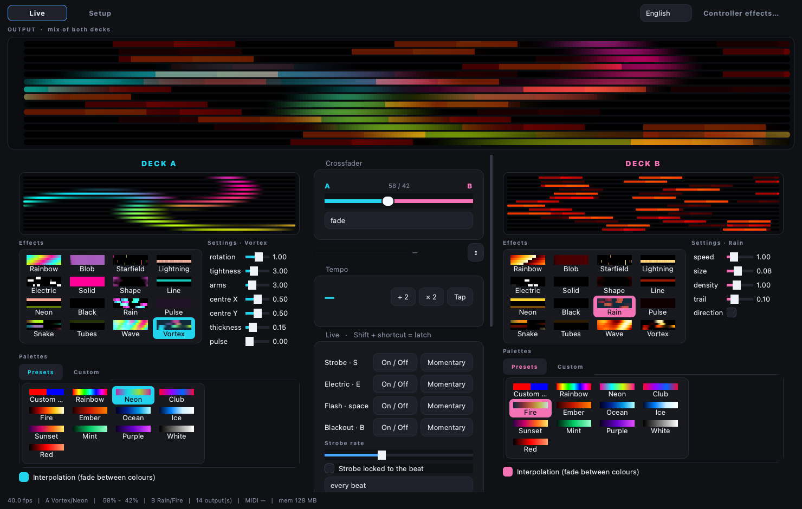
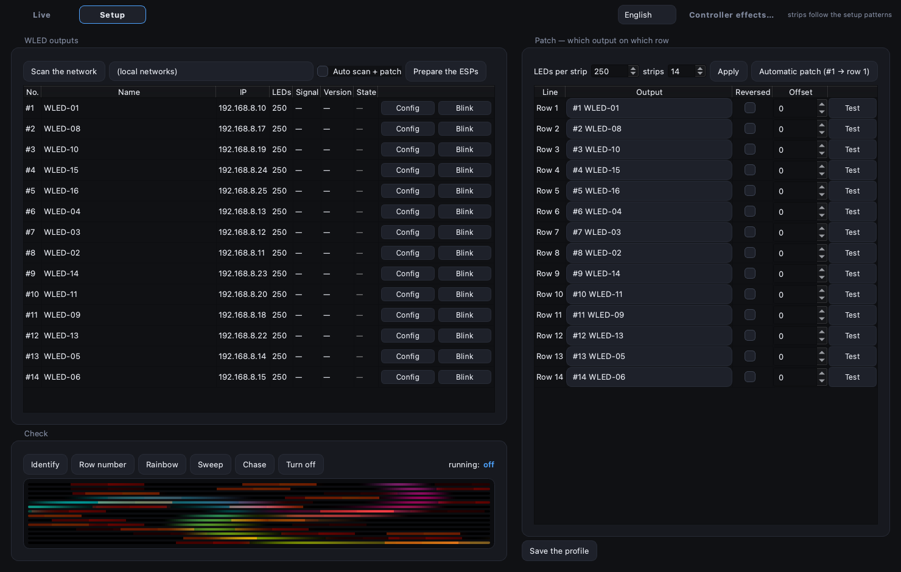

# leddeck

**leddeck** drives WLED LED strips over DDP from a Mac, as a live VJ instrument.

It was built by [**association Eclipse**](#credits) to replace MadMapper on our club
rig: 14 WiFi ESP boxes, one 250-LED tube each, one audio input, one Akai APC mini MK2,
and a laptop that has to survive a whole night without being touched.

 



*Deck A running Vortex on the Neon palette, deck B running Rain on Fire, mixed at 58/42.
The bar at the top is what the 14 tubes are actually showing.*

---

## What it does

- **Two decks and a crossfader.** Each deck has its own effect, its own palette and its
  own parameters, with a live preview of A, B and the mix. The crossfader can follow
  the beat automatically.
- **16 effects**, several of them ported from ISF shaders: rainbow, blob, starfield,
  lightning, electric, solid, shape, line, neon, black, rain, pulse, snake, tubes,
  wave, vortex. All of them render a 250 × 14 matrix in under 0.35 ms per frame.
- **12 palettes** plus a custom palette you build yourself, with optional interpolation
  between colours (stepped palettes matter: a two-colour pulse should flip between the
  two, not fade through the middle).
- **Audio reactivity from a live input.** Sliding 2048-point FFT with a 512 hop, three
  bands, spectral-flux onset detection restricted to 20–250 Hz, beats snapped to a
  tempo grid, BPM by autocorrelation with ÷2 / ×2 correction and tap tempo. Automatic
  gain follower, so the show does not die when the DJ turns down.
- **Master section**: brightness, global speed (down to a full freeze), blackout,
  strobe with beat divisions from 1/8 to 8 per beat, white flash, and an electric
  overlay that sparks on top of whatever is playing.
- **MIDI control** for the APC mini MK2: effects, palettes, eight fixed colours,
  faders for effect parameters, and live functions with a latched and a momentary mode
  each. Pad LEDs reflect state (colour, brightness, blink). Soft takeover on the faders,
  so moving a slider never jumps a value.
- **Setup page** to discover the WLED boxes on the network, identify them
  physically (each strip displays its own number), patch them to matrix rows, watch
  their reachability and configure them remotely.
- **French and English throughout** — the interface, the command line and the printable
  MIDI sheet. French is the source language; English is a translation table, so a missing
  string falls back to French instead of breaking anything. Effect and palette names are
  shown translated and accepted in either spelling.

The matrix model is deliberately simple: **L LEDs × N strips**. There is no 2D spatial
mapping, and that is on purpose — a rig of parallel tubes does not need one.

## Install

Requires Python 3.12 and [uv](https://docs.astral.sh/uv/).

```bash
git clone https://github.com/jerome-esim/leddeck.git
cd leddeck
uv sync
```

## Quick start

```bash
# 1. create a room profile
uv run leddeck --profile club profile init --leds 250 --strips 14

# 2. find the WLED boxes on the network
uv run leddeck --profile club discover

# 3. open the app (Live page and Installation page in one window)
uv run leddeck --profile club ui
```

On the **Setup** page: scan, patch each output to a matrix row, hit *identify* to see
which physical tube is which, then switch to **Live**.



Strips can be installed in any order and put back in order here — the patch decides which
output feeds which matrix row, and whether it runs reversed.

### Command line

| Command | What it does |
| --- | --- |
| `leddeck ui` | the application (Live + Installation) |
| `leddeck install` | same application, opened on the Installation page |
| `leddeck discover` | scan the network for WLED devices |
| `leddeck identify` | every strip displays its own number |
| `leddeck blink 7` | blink one output, to find it in the rack |
| `leddeck test sweep` | test pattern on the whole matrix |
| `leddeck fx list` / `fx run Serpent --palette Feu` | effects from the terminal |
| `leddeck audio devices` / `audio monitor` / `audio leds` | audio input checks |
| `leddeck midi ports` / `midi monitor` / `midi sheet` | MIDI checks, printable mapping sheet |
| `leddeck prepare` | configure the ESPs for the venue (see below) |
| `leddeck diag` | diagnostic pattern on one output |
| `leddeck off` / `leddeck on` | blackout and power the strips off / back on |

`--profile <name>` and `--lang fr|en` are global and go **before** the command:
`leddeck --profile club --lang en ui`. Without `--lang`, the profile's language is used.

## Hardware

| Part | What we use |
| --- | --- |
| Controllers | ESP8266 / ESP32 running [WLED](https://kno.wled.ge/), static IPs |
| Strips | 250 RGB LEDs per tube, 14 tubes |
| Network | dedicated WiFi router, Mac wired over Ethernet |
| Audio | line input from the mixer (a microphone also works) |
| MIDI | Akai APC mini MK2 |

**Protocol.** DDP over UDP, 10-byte header, RGB24, one packet per frame per output
(250 LEDs = 750 bytes, well under the 1440-byte limit). At 40 fps and 14 outputs that
is 560 packets per second — a cheap ESP8266 keeps up with it, measured while streaming.

**`leddeck prepare`** writes the venue settings to every box over the WLED JSON API:
force max brightness, no colour correction, realtime enabled, and *power off at boot*,
so that if the application is killed the tubes go dark instead of falling back to a
WLED demo effect. Note that WLED applies and saves configuration changes with a delay —
reading the config back immediately returns the old values.

## Project layout

```
leddeck/
  core/      profile, render engine, mixer, decks, master, palettes, parameters
  effects/   the 16 effects, each one a small class over a numpy matrix
  audio/     input capture and analysis (FFT, bands, onsets, tempo)
  midi/      controller link, mapping, actions, LED feedback, printable sheet
  output/    DDP sender, patch, WLED JSON client
  ui/        PySide6 interface: live page, installation page, previews, theme
  install/   patterns used to identify and test the rig
profiles/    room profiles (matrix size, outputs, patch, audio settings)
midi/        MIDI mappings
```

`PLAN.md` holds the design decisions and the build log, in French — `PLAN.en.md` is the
English translation, kept behind the French, which stays the reference.

## Credits

Built by **association Eclipse**.

Written in French internally: the code comments and `PLAN.md` are in French. The interface
speaks both languages, and `PLAN.en.md` mirrors the plan in English.

## License

MIT. See [LICENSE](LICENSE).
